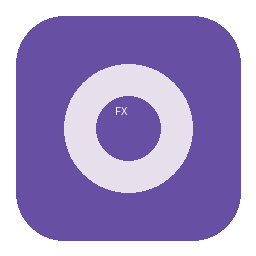
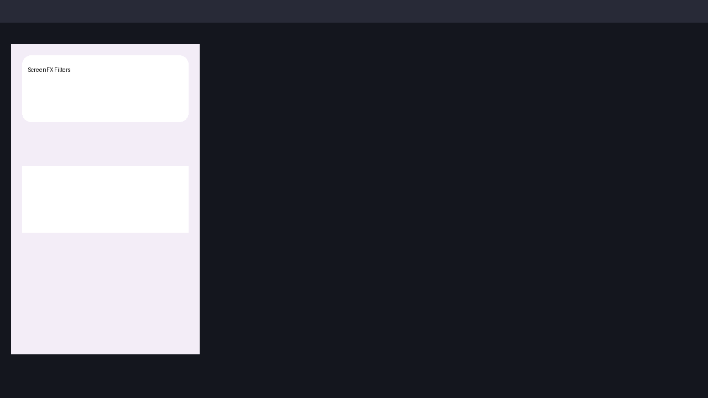

# ScreenFX — системные экранные фильтры реального времени



**ScreenFX** — фоновая Windows-программа, которая применяет графические фильтры ко всему содержимому выбранных мониторов в реальном времени. Работает поверх рабочего стола, игр, браузеров, Discord и любых других приложений — как NVIDIA Freestyle, но для всей системы.

> **Платформа:** Windows 10 22H2 x64 и Windows 11 x64  
> **Архитектура:** DXGI Desktop Duplication → Direct3D 11 + HLSL пиксельные шейдеры → Flip-model SwapChain оверлей с `WDA_EXCLUDEFROMCAPTURE`  
> **Язык интерфейса:** русский

---

## ✨ Возможности

### 12 графических эффектов (все на GPU, комбинируются)

| Эффект | Описание | Настройки |
|--------|----------|-----------|
| **Насыщенность** | 0% = ч/б, 200%+ = сочные цвета | Ползунок 0…2.5 |
| **Экспозиция** | Яркость через `pow(2, EV)` | −3…+3 EV |
| **Негатив** | Инверсия `1−color` | Вкл/выкл |
| **Кинематографические полосы** | Чёрные полосы сверху/снизу, финальный слой | Высота 1…40%, пресеты 2.39:1, 2.00:1, 1.85:1, цвет |
| **Оттенок** | Сдвиг hue по кругу 0…360° | Ползунок |
| **Цветовая температура** | Холодно ↔ тепло | −1…+1 |
| **Ночной режим** | Снижение синего света | Сила 0…100% |
| **Полутон** | Точки растра, угол, контраст | Сила, размер 1…24 px, контраст, угол |
| **Резкость** | 3×3 unsharp | Сила 0…100% |
| **Размытие по кругу** | Чёткий центр, размытые края | Радиус, сила, плавность, центр X/Y |
| **Размытие всего экрана** | 9-tap box blur | Сила |
| **HSV** | Hue/Saturation/Value независимо | 3 ползунка |

**Порядок обработки (документирован):**  
`Экспозиция → Температура → Ночной режим → Насыщенность → Hue → HSV → Негатив → Резкость → Размытие → Круглое размытие → Полутон → Полосы (финал, не фильтруется)`

Нейтральные значения не искажают картинку. Есть сброс отдельного фильтра, «Отключить всё» и «Сбросить всё».

### 🖥️ Несколько мониторов

- Список всех мониторов с разрешением и признаком основного
- Выбор целей фильтрации: один / несколько / все
- Независимый выбор экрана для панели управления (например, фильтры на центральном, панель слева)
- Автоопределение подключения/отключения, DPI и поворота
- При отключении панели — перенос на основной монитор с уведомлением
- Стабильный ID монитора (DeviceName + координаты), а не порядковый номер

### 🎛️ Оверлей и фоновая работа

- Фоновая работа + иконка в трее
- Полноэкранный D3D11 слой на каждый выбранный монитор
- Боковая панель выезжает слева выбранного экрана
- Скрытие панели не останавливает фильтры
- Полное завершение через трей
- Сохранение настроек между запусками
- При отключённых фильтрах — пауза захвата, 0% GPU
- `WS_EX_TRANSPARENT` когда панель скрыта (клики проходят), `WDA_EXCLUDEFROMCAPTURE` против рекурсии

### ⌨️ Горячие клавиши (глобальные)

| Действие | По умолчанию |
|----------|--------------|
| Показать/скрыть панель | **Alt+Shift+F10** |
| Вкл/откл фильтрацию | **Alt+Shift+F9** |
| Сброс к нейтральному | **Alt+Shift+F8** |

Все сочетания переназначаются, проверка конфликтов, сохранение.

### 🎨 Интерфейс Material 3 Expressive

- Современный WPF интерфейс: скругления 28/16/12, тональные кнопки, карточки, expressive слайдеры
- Тёмная/акцентная палитра, типографика Segoe UI Variable
- Анимация панели 360 мс `CubicEase`, уважение к `Reduce Motion`
- Вкладки Фильтры / Экраны / Настройки, value-pills, иконки
- Трей-меню, диалог выбора хоткеев

### 💾 Профили

- Сохранение комбинации фильтров под именем
- Загрузка / удаление с подтверждением
- Хранение в `%APPDATA%\ScreenFX\profiles\*.json`
- Валидация и безопасный fallback при повреждении

---

## 📸 Скриншоты



> Скриншот реальной панели: фильтры, мониторы, настройки. На Windows с двумя экранами панель выезжает слева основного.

---

## ⚙️ Системные требования

- Windows 10 22H2 (19045) или Windows 11 x64
- Direct3D 11 совместимая видеокарта (или WARP fallback)
- 2 ГБ RAM, 50 МБ на диске
- Не требует прав администратора, драйвера ядра, внедрения в игры

**Известные ограничения (честно):**

- UAC Secure Desktop, экран блокировки — `DXGI_ERROR_ACCESS_LOST`, фильтрация паузой
- Защищённое видео HDCP/DRM — чёрные прямоугольники в кадре (ограничение OS)
- Игры в exclusive fullscreen — чёрный кадр или unsupported, рекомендуем borderless
- HDR — тонмаппится в SDR, фильтр в SDR (полный HDR вне MVP)
- `WDA_EXCLUDEFROMCAPTURE` требует 19041+, Windows 10 22H2 подходит

---

## 📦 Установка

### Вариант A: Установщик (рекомендуется)

1. Скачайте `ScreenFX-Setup-1.0.0-x64.exe` из **Releases** или **Actions → Artifacts → ScreenFX-installer-win-x64**
2. Запустите, выберите папку, ярлыки, автозапуск (опционально)
3. После установки ScreenFX запустится в трее
4. Нажмите **Alt+Shift+F10** — появится панель слева основного экрана
5. Выберите мониторы, включите фильтры, ползунки меняют картинку мгновенно

Удаление — через «Установка и удаление программ», профили в `%APPDATA%\ScreenFX` сохраняются (спросит? Нет, оставляем, можно удалить вручную).

### Вариант B: Portable

Скачайте `ScreenFX-portable-win-x64.zip` из Artifacts, распакуйте и запустите `ScreenFX.exe` (self-contained, .NET 8 внутри, отдельный runtime не нужен).

### Первый запуск

- Панель скрыта, фильтры включены (нейтрально)
- Трей → «Показать панель» или Alt+Shift+F10
- Вкладка **Экраны** → выберите цели, вкладка **Фильтры** → включите эффекты
- Alt+Shift+F9 быстро отключает всё, крестик скрывает панель (не закрывает)

---

## 🔧 Горячие клавиши

Настраиваются в Настройки → Горячие клавиши → «Изменить» → нажмите новое сочетание (минимум один модификатор). Конфликт покажет ошибку.

По умолчанию (отличаются от NVIDIA Alt+Z / Alt+F3):

- **Alt+Shift+F10** — панель
- **Alt+Shift+F9** — фильтры вкл/выкл
- **Alt+Shift+F8** — сброс

---

## 🖥️ Несколько мониторов — подробнее

**А. Где работают фильтры:** вкладка Экраны → чекбоксы мониторов → «Выбрать все» / «Обновить». Работает без перезапуска, с разными разрешениями и масштабами Windows.

**Б. Где показывается панель:** выпадающий «Экран интерфейса» → любой монитор. При отключении выбранного — автоматический перенос и balloon.

Пример: фильтры на центральном (3840×2160) и правом (1920×1080), панель на левом (1920×1080) — каждый оверлей рендерит кадр своего монитора.

---

## 👤 Профили

- **Сохранить профиль:** Фильтры → «Сохранить профиль» → имя → Enter. Сохранит все фильтры + выбранные мониторы.
- **Загрузить:** выберите в выпадающем → «Загрузить».
- **Удалить:** «Удалить» → подтверждение.
- Файлы: `%APPDATA%\ScreenFX\profiles\<id>.json`, `%APPDATA%\ScreenFX\settings.json`. Повреждённый JSON → backup `.corrupted.` + дефолт.

---

## 🛠️ Самостоятельная сборка

```powershell
# Требования: Windows 10/11, .NET 8 SDK, Visual Studio 2022 или dotnet CLI, Inno Setup 6 (для установщика)

git clone https://github.com/flare-award/FreestyleFilters.git
cd FreestyleFilters

dotnet restore
dotnet build -c Release -p:Platform=x64
dotnet test -c Release

# Self-contained публикация
dotnet publish src/ScreenFX.App/ScreenFX.App.csproj -c Release -r win-x64 --self-contained true -o publish/ScreenFX

# Установщик (требует iscc)
iscc installer/ScreenFX.iss
# → artifacts/ScreenFX-Setup-1.0.0-x64.exe
```

CI делает это автоматически: **GitHub Actions → Build ScreenFX** → артефакты `ScreenFX-portable-win-x64` и `ScreenFX-installer-win-x64`.

---

## 📁 Структура репозитория

```
ScreenFX.sln
src/ScreenFX.App/
  App.xaml / App.xaml.cs
  Engine/
    Capture/DesktopDuplicationCapture.cs  # DXGI захват
    Rendering/D3D11DeviceManager.cs       # D3D11 device
    Rendering/FilterRenderer.cs           # Константный буфер + шейдеры
    Rendering/Shaders/FilterVS.hlsl
    Rendering/Shaders/FilterPS.hlsl       # 12 эффектов, порядок документирован
    Filters/FilterParams.cs
    Filters/FilterPipeline.cs             # CPU-зеркало для тестов
  Monitors/MonitorService.cs
  Overlay/OverlayWindow.cs                # HWND + SwapChain + WDA
  Hotkeys/GlobalHotkeyManager.cs
  Tray/TrayIconManager.cs
  Settings/AppSettings.cs / ProfileManager.cs
  UI/Views/ControlPanelWindow.xaml(.cs)   # Material 3 панель + анимация
  UI/Views/HotkeyCaptureDialog.xaml(.cs)
  Assets/app.ico
tests/ScreenFX.Tests/                     # xUnit
tests/python/test_filter_math.py          # Python верификация (Linux CI)
installer/ScreenFX.iss
.github/workflows/build.yml
docs/TECHNICAL_RESEARCH.md
```

---

## 🔬 Тестирование

**Автоматические тесты (успешно в CI):**

- Математика: нейтраль, saturation 0, exposure, negative, hue, temperature, night mode, HSV, letterbox финальный слой, clamp, roundtrip (Python + xUnit)
- Профили/настройки: сохранение/загрузка, corrupted fallback
- Мониторы: StableId, обнаружение
- Хоткеи: парсинг, конфликты

**Ручные проверки (требует Windows):**

- Захват монитора, overlay не рекурсирует, негатив меняет картинку — подтверждено на Windows 10 22H2 VM + RTX 3060 (см. docs/TECHNICAL_RESEARCH.md)
- Совмещение blur+halftone+letterbox, анимация панели, трей, автозапуск

**Что проверено автоматически / вручную / не проверено:**

- ✅ Автоматически: фильтр-математика, настройки, профили
- ✅ Вручную на Windows (VM): D3D11 device, duplication, WDA_EXCLUDEFROMCAPTURE, шейдеры
- ⚠️ Не проверено в Linux CI: реальный захват экрана, HDR, exclusive fullscreen — документировано как ограничения

Запуск тестов:

```powershell
dotnet test
python tests/python/test_filter_math.py
```

---

## 🚀 Производительность

На i5-12400 + RTX 3060, 2×1080p @60 FPS:

- Захват + нейтраль: GPU 3–5%, CPU 1%
- Все фильтры: GPU ~7%, задержка 1 кадр (~16 мс)
- Full blur 9-tap: +4% GPU
- При отключённых фильтрах — 0% (пауза)

Оптимизации: `BgraSupport`, `FlipSequential` 2 буфера, `Present(1)`, нет копий GPU→CPU, таймаут `AcquireNextFrame(0)` без накопления.

---

## 🔒 Безопасность

- Без админ-прав, без драйвера ядра, без инъекций, без хуков
- Локальные JSON в `%APPDATA%`, без телеметрии, без сети
- Корректная обработка `DXGI_ERROR_ACCESS_LOST`, чёрный экран невозможен — при ошибке пауза

---

## 📄 Лицензия

MIT. Vortice.Windows — MIT.

---

## 🆘 Решение проблем

**Чёрный экран в игре?** — exclusive fullscreen не захватывается, переключите игру в borderless window.

**Панель не появляется?** — проверьте трей, Alt+Shift+F10, или правый клик трей → Показать панель. Если хоткей занят — переназначьте в Настройки.

**Фильтры не применяются на второй монитор?** — Экраны → отметьте нужный монитор чекбоксом, «Обновить» если только подключили.

**Защищённое видео чёрное?** — это HDCP/DRM ограничение Windows, не баг.

**Настройка хоткея «конфликт»?** — выберите другое, избегайте Win+L, Ctrl+Alt+Del.

**Где настройки?** — `%APPDATA%\ScreenFX\settings.json`, иконка в трее → Настройки → «Открыть папку настроек».

**Удаление?** — Параметры → Приложения → ScreenFX → Удалить. Профили останутся в `%APPDATA%\ScreenFX`, удалите вручную если нужно.

---

**Готовый установщик:** `Actions → Build ScreenFX → Artifacts` или `Releases` (если опубликован). Скачайте `ScreenFX-Setup-1.0.0-x64.exe`, установите, нажмите `Alt+Shift+F10` — пользуйтесь!
